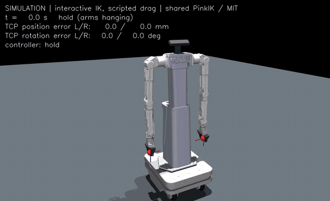

# Hexfellow Deploy (handover copy)

Deployment runtime for the **Hexfellow Maver X4** mobile manipulator (swerve base, lift,
two 7-DoF arms, GP80 grippers, ZED 2i head camera): robot model, IK, control stack and a
MuJoCo simulator with mouse-draggable IK targets. The same controller drives the
simulator and the real robot; only the device adapters differ.

This is a snapshot of `main` of `ZiWang1105/hexfellow-deploy` (commit `ac7da9d`, 2026-10-17).
The original, more detailed README is in [docs/DETAILED_README.md](docs/DETAILED_README.md).

## Quick start (simulation)

Ubuntu, with `build-essential`, `libeigen3-dev` and [`uv`](https://github.com/astral-sh/uv):

```bash
git clone https://github.com/ZiWang1105/hexfellow-deploy-106.git
cd hexfellow-deploy-106
./scripts/setup_sim.sh          # Python 3.10 .venv, simulation deps, builds the native extension
```

Then open the interactive IK simulator (see below). Nothing in the simulation commands
opens hardware.

## 1. Robot model (URDF)

`robot_resources/urdf/`

| File | What it is |
| --- | --- |
| `maver_x4_asm_asm.urdf` | Maver X4 as delivered: base, lift, two 7-DoF arms, no grippers |
| `maver_x4_gp80.urdf` | + a GP80 gripper on each arm |
| `maver_x4_gp80_zed.urdf`, `maver_x4_gp80_zed_<N>deg.urdf` | + the ZED 2i head camera at a pitch of N deg (32/40/42/55) |
| `vendor/hexfellow_gp80/xpkg_urdf_gp80.urdf` | the vendor's GP80 description |

Meshes are in `robot_resources/urdf/meshes/`. Notes:

* The GP80 is a **single rigid body** (`robot_base`, `robot2_base`); the URDF has no finger
  joints. The grippers are driven open/closed by the gripper controller (section 3).
* The URDF has **no TCP frame**: the IK adds it at load time from `tcp_offset_m` in the robot
  model config (`src/hexfellow_deploy/robotics/control/robot_model.py`).
* The default runtime config `configs/hardware/desktop.yaml` uses
  `maver_x4_gp80_zed_40deg.urdf`.

## 2. IK

Differential IK with [Pink](https://github.com/stephane-caron/pink) on Pinocchio, solved as a
QP each control tick, with joint, velocity, acceleration, jerk, effort and self-collision
constraints. Default profile: `x7-gp80-general-trajectory-sim-v2` at 100 Hz (2.0 m/s,
4.0 rad/s target limits).

| Where | What |
| --- | --- |
| `src/hexfellow_deploy/robotics/control/ik_core.py` | the IK controller (entry point) |
| `.../control/qp_pipeline.py`, `posture.py`, `posture_policy.py` | QP tasks and posture regularisation |
| `.../control/self_collision.py`, `collision_kernel.cpp` | self-collision checks (native C++ kernel) |
| `.../control/motion_profile.py`, `target_timing.py` | target trajectories and timing |
| `configs/controller/` | controller profiles (`x7_general_trajectory_sim.yaml`, `umi_pink*.yaml`, ...) |
| `docs/GENERAL_IK.md`, `docs/IK_BENCHMARK.md` | design notes and benchmarks |

## 3. Control stack

```
policy / operator request (paired left/right TCP poses, grippers, base velocity)
  -> IK (PinkIK, above)            joint references
  -> MIT command                   position/velocity/torque + gains per joint
  -> backend process               validation, ownership, command health
  -> device adapter                MuJoCo simulator  |  Hexfellow SDK (real robot)
  <- feedback (encoders, camera)   checked for freshness, order and consistency
```

| Where | What |
| --- | --- |
| `src/hexfellow_deploy/robotics/control/` | MIT commands (`mit.py`, `mit_command.py`), limits (`command_limits.py`), following error, feedback policy, faults |
| `src/hexfellow_deploy/robotics/hardware/` | real robot: SDK endpoint (`hexfellow_endpoint.py`, `x7.py`), whole-body mapping (`whole_body.py`), realtime loop, sessions |
| `src/hexfellow_deploy/backend.py`, `native.py`, `actuation.py`, `control_topics.py` | the process/topic runtime between controller and devices |
| `src/hexfellow_deploy/sim/` | MuJoCo scene builder, sensors, simulated transport |
| `src/hexfellow_deploy/gripper_sdk.py`, `gripper_contract.py` | GP80 open/close control (`docs/GRIPPER_CONTROL.md`) |
| `configs/hardware/`, `configs/robot/`, `configs/scenes/` | runtime, robot and scene configs |
| `docs/ARCHITECTURE.md` | architecture and ownership rules |

## 4. Interactive simulator IK

A MuJoCo window with draggable red TCP targets; the arms follow through the same IK and
control path as the real robot (no policy, no API calls, no hardware):



*A scripted drag through the same request path as the mouse (red spheres: targets): both
hands up to a work pose, a 6 cm circle, a 30° rotation, both arms together and a fast 10 cm
flick. While a target moves the TCP lags it by up to ~3 cm and settles within ~3-5 mm; at
the end both targets are just beyond reach and the arms hold steadily ~28 mm short.*

To open the window:

```bash
OMP_NUM_THREADS=1 OPENBLAS_NUM_THREADS=1 .venv/bin/hexfellow-deploy \
  --interactive-ik --no-camera \
  --output "runs/interactive_ik_$(date +%Y%m%d_%H%M%S)"
```

* **Double-click** a red sphere to select the left or right TCP.
* **Ctrl + right-drag** translates it, **Ctrl + left-drag** rotates it.
* **Space** or **R**: hold and reset the handles to the measured TCP poses.
* **Q** or close the window to quit.
* A web dashboard runs at <http://127.0.0.1:8765/>.
* `runs/<name>/interactive.jsonl` records the input, `control.jsonl` the measured and reference motion.

Code: `src/hexfellow_deploy/interactive.py`.

## Real robot

The same mouse dragging on the real robot is `src/hexfellow_deploy/hardware_interactive.py`,
documented in [docs/HARDWARE_INTERACTIVE_IK.md](docs/HARDWARE_INTERACTIVE_IK.md). Hardware runs
need the optional SDK (`uv pip install --python .venv/bin/python -e '.[hardware]'`), a
machine-local deployment config and the explicit flags `--execute --confirm-onsite-ready`.
The configs in this repository are uncommissioned templates; simulation results do not
qualify hardware safety.

## Tests

```bash
OMP_NUM_THREADS=1 OPENBLAS_NUM_THREADS=1 .venv/bin/python -m pytest tests -q
```

## Licenses

Source lineage and preserved license terms: [NOTICE.md](NOTICE.md), `licenses/`.
