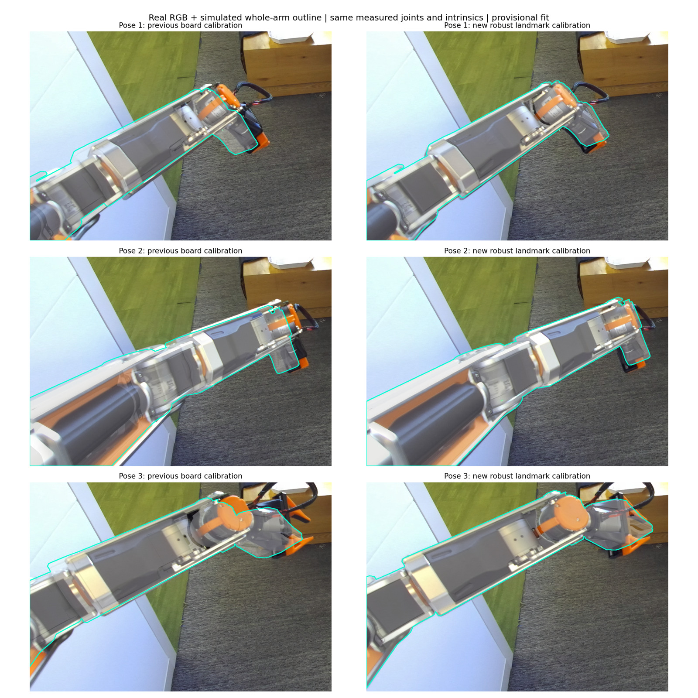

# ZED camera calibration on the Hexfellow robot

This guide records the calibration performed on September 30, 2026: the coarse
right-hand board fit and the finer left-arm landmark PnP fit. It covers capture,
measured-joint replay, algorithms, current extrinsics and numerical reproduction.

The latest result is
[zed_landmark_candidate_20260930.json](../config/camera/zed_landmark_candidate_20260930.json).
It improves arm-landmark reprojection RMS from **57.7 to 11.9 pixels**, with
**14.9–16.8 pixel RMS on held-out poses**. This is the current candidate estimate,
not independently established ground truth. The original calibration launcher kept the refined estimate separate. The
parent deployment currently selects it through `configs/local/desktop.yaml`;
this migration does not change that selection. The original board solution remains in
[zed_candidate_20260930.json](../config/camera/zed_candidate_20260930.json).

## Physical setup and environment

The ZED 2 is attached to the moving lift with the shorter **40-degree supporter**;
its USB connects to the desktop. Capture and robot feedback run on that desktop.
This workflow does not require SSH access to the Hexfellow console. Use the
[camera-equipped URDF](../urdf/maver_x4_gp80_zed_40deg.urdf).

Rigidly tape the board to the **outward face of the right hand**, facing the
robot's right side at rest. Attach the backing to a rigid hand part, not a moving
finger. Prevent sliding or flexing and keep the complete pattern and white
surround visible. The exact board-to-hand offset is solved by calibration, but
the attachment must remain unchanged throughout capture.

| Board parameter | Actual print used |
|---|---|
| Pattern | 5 × 5 ChArUco squares, 16 internal corners |
| Dictionary | `DICT_4X4_50`, marker IDs 0–11 |
| Patterned area | **87 × 87 mm**, measured after printing |
| Square side | **17.4 mm** |
| Marker side | 11.6 mm, inferred from uniform print scaling |
| Rigid backing | 100 × 100 mm |
| Configuration | [charuco_87mm.json](../config/camera/charuco_87mm.json) |

Use the measured **87 mm pattern**, not the 100 mm backing or nominal 90 mm PDF
pattern, for object coordinates. Uncertainty in print scale affects metric
translation accuracy. Keep the printed surface flat and matte.

The camera checkout uses the installed sibling deployment environment:

```bash
cd ~/projects/agentic-mobile-manipulator/third_party/hexfellow-deploy/calibration
source ../../../.venv/bin/activate
export OMP_NUM_THREADS=1 OPENBLAS_NUM_THREADS=1 MKL_NUM_THREADS=1
export MUJOCO_GL=egl
```

A fresh installation also needs the ZED SDK/Python API and Hexfellow hardware
extra; see [installation](../README.md) and [live setup](camera_calibration_live.md).
The reviewed robot mapping and research binding are machine-specific files in
the deployment's ignored `config/local/`, not supplied by the public templates.
Keep one robot-control process and one ZED capture owner running at a time.

## Frames and measured joint mapping

`T_destination_from_source` maps source coordinates into destination coordinates:

$$p_{destination}=T_{destination\_from\_source}\,p_{source}.$$

All transforms are homogeneous 4 × 4 matrices with translations in **meters**.
Joint angles are radians unless labeled degrees; lift displacement is meters.

| Frame | Exact identifier or convention |
|---|---|
| Camera | Rectified **LEFT** optical: X right, Y down, Z forward |
| Moving camera mount | `maver_x4_asm_URDF_link_1` |
| Right-hand flange | `maver_x4_asm_mount2` |
| Robot base | `maver_x4_asm_maver_x4_base_link` |

The MuJoCo body named `robot_base` belongs to the left gripper; do not use it as
the robot root. Camera-to-lift is fixed. Camera-to-base changes with lift:

$$T_{base\_from\_camera}(q)
=T_{base\_from\_mount}(q)\,T_{mount\_from\_camera}.$$

Use the current **both_j6** mapping consistently for control, measured FK and
replay. Both arms have SDK indices `[0,1,2,3,4,5,6]` and signs
`[1,1,-1,1,-1,-1,-1]`; J1 offsets are +π/2 for left and −π/2 for right:
`q_model = signs * q_sdk[indices] + offsets`. Installation transforms for left and
right are separately encoded in the URDF. See the
[mapping template](../config/hardware/hexfellow_gp80_highspeed_both_j6.json).

Saved `q` has 18 coordinates: base X/Y/yaw, lift, left J1–J7, right J1–J7.
Historical `right_j6` captures used left J6 sign +1. Recover their original SDK
angles with the old mapping, then apply the new mapping; never reinterpret old
model angles directly. Keep original captures unchanged. The converted default
also preserves the original physical SDK motor targets.

## Stage 1 Coarse board calibration

### Validate the right-hand route in simulation

The 30 targets are in
[right_centered_candidates.json](../config/camera/right_centered_candidates.json).
The rough outward attachment estimate is in
[board_right_centered.json](../config/camera/board_right_centered.json).

```bash
python tools/camera/verify_centered_calibration.py \
  --snapshot config/camera/both_j6_sim_start.json \
  --attachment config/camera/board_right_centered.json \
  --candidates config/camera/right_centered_candidates.json \
  --output runs/calibration-route-review
```

Inspect the report and rendered views before a physical run. The saved check
placed pattern centers within approximately 94 pixels horizontally and 71
vertically of image center, with at least 362 pixels of image-edge margin. Paths
require 15 mm modeled clearance. These checks use estimated board/camera geometry;
room objects, people and cables are not modeled. The live planner checks the
approach again from the actual measured robot state.

### Capture automatically through the website

Power the robot, connect its configured Ethernet interface, and run the read-only
startup probe. It acquires no robot control:

```bash
./tools/camera/run_calibration.sh --mode live --probe
```

Inspect the printed audit if network, battery, timing or feedback is rejected.
The existing `hexfellow-discovery` network profile on this desktop prevents generic
DHCP reconnects; see [network and retry instructions](camera_calibration_live.md).
Do not relax feedback guards to get past a failed audit.

When the workspace and cable routing are ready:

```bash
./tools/camera/run_calibration.sh --mode live --confirm-onsite-ready
```

Open **http://127.0.0.1:8772** after startup passes. Operation order:

1. Check the image and board attachment. If needed, click **Move to default pose ·
   lift 300 mm** and wait for completion. This is the full default;
   **Return arms to default** instead retains current lift/base position.
2. Click **Start calibration** once. It moves, waits, captures and advances through
   all 30 targets automatically. The page shows pose ID and progress.
3. Use **Pause** or Space for controlled stopping, then Start/Resume explicitly.
   Capture and Next are available for individual inspection.
4. Review eligible/invalid counts and outputs, then **Stop & quit** to release
   control. Quitting the board sequence does not implicitly return to default.

Capture requires fresh stationary measured feedback for one second, image/joint
time pairing and a geometry check. The active arm may be within **5 degrees per
joint** of target; calibration uses its **measured angles**. Base/lift/other-arm
checks retain their separate tolerances. Poor images and unreachable targets are
labeled invalid and skipped after controlled stationary HOLD. Feedback, power,
controller and unsafe-current-state faults still stop the session.

Each run saves `dataset.json`, full-resolution LEFT RGB, measured `q`, FK,
timestamps/skew, settling diagnostics and invalid reasons. Camera intrinsics come
from the SDK's current rectified LEFT calibration. Depth and desired joint angles
are not used to estimate these extrinsics.

### Board detection and the actual fallback used

The normal detector uses marker identities and refined ChArUco internal corners,
then planar PnP for $C_i=T_{camera\_from\_board,i}$. Its pose-estimation minimum is
8 corners; live eligibility requires 12. In physical run
`20260930T220448.229707Z`, only **2 of 30** images met the 12-corner gate. The other
28 had 0–10 detected corners. Those were visual rejections, not 28 demonstrated
kinematic failures.

This run's coarse solution instead used an **offline provisional marker-guided
pattern-boundary fallback**:

1. Decode ArUco IDs 0–11 and match their known board coordinates.
2. Fit a planar homography with RANSAC, 2-pixel threshold.
3. Project the four **87 mm pattern** corners, not backing corners. Refine with
   `cornerSubPix`, 6 × 6 window, 60 iterations and 0.001 tolerance.
4. Cross-check the refined corner homography against all decoded marker points.
5. Run `solvePnPGeneric(..., SOLVEPNP_IPPE)` using matching K and zero distortion.
   Retain candidates with best IPPE error below 1 pixel and marker cross-check RMS
   below 2 pixels. Inspect positive depth and the second planar solution; in the
   retained data, second-solution errors were above 1 pixel.

This recovered **26 provisional board poses**. Marker identities anchor corner
order; an unmarked square alone has orientation ambiguity. The fallback does not
automatically promote invalid live observations to qualified data. The frozen
reference pairs retain detected corners, measured FK and source-image hashes.

### Jointly solve camera and board transforms

Measured FK provides $G_i=T_{mount\_from\_hand,i}$. Solve the two constants
$X=T_{mount\_from\_camera}$ and $Y=T_{hand\_from\_board}$ from:

$$X C_i = G_i Y.$$

[handeye.py](../src/policy_sim/calibration/handeye.py) uses OpenCV Park initialization
and joint preconditioned gradient descent with pseudo-Huber loss and Armijo line
search. Translation/rotation residual scales are 2 mm and 0.01 rad. Rotations stay
in SO(3): this is a 12-degree-of-freedom fit, not unconstrained matrix entries.
The solver checks independent rotational excitation and Jacobian conditioning.

Every fifth recovered observation is held out: **21 training, 5 validation**.
The first fit converged in 547 iterations. Closure RMS was **4.33 mm / 0.98°** on
training, **5.16 mm / 1.39°** held out. Closure measures consistency of the equation,
not camera accuracy against physical ground truth.

Reproduce the actual coarse fit from versioned numerical pairs:

```bash
python tools/camera/refit_coarse_reference.py \
  --pairs artifacts/reference/camera-calibration/coarse-board-pairs.json \
  --output runs/calibration-reproduction/coarse.json
```

For a new dataset with **30 fully accepted stationary synchronized** captures:

```bash
python tools/camera/solve_handeye.py path/to/dataset.json \
  --output runs/new-calibration/extrinsics.json
```

The live automatic solve requires at least 12 eligible captures. Neither normal
entrypoint's gate was bypassed for the 26 provisional fallback observations;
their offline reproduction is explicitly separate.

## Stage 2 Left-arm landmark PnP refinement

### Capture three left-arm views

Check the right-hand fit independently with the **whole left arm**. The three
targets and nominal MIT simulation evidence are versioned in
[left-validation-plan.json](../artifacts/reference/camera-calibration/left-validation-plan.json)
and [left-validation-simulation.json](../artifacts/reference/camera-calibration/left-validation-simulation.json).
All three paths and the return completed; 2,812 measured simulated samples passed
15 mm clearance checks, with at most 0.0054° target error. This does not establish
physical room clearance. Rerun the saved simulation:

```bash
python tools/camera/verify_left_hand_validation.py \
  --plan artifacts/reference/camera-calibration/left-validation-plan.json \
  --output runs/left-validation-review
```

This saved dynamics plan includes the original desktop's deployment mapping and
extrinsic paths. On another machine, regenerate the plan with
`tools/camera/plan_left_hand_validation.py` and that deployment's reviewed mapping
before running the verifier; do not substitute a different mapping under the
recorded evidence hashes.

After releasing any other control session, launch:

```bash
./tools/camera/run_left_hand_validation.sh --mode live --confirm-onsite-ready
```

Open **http://127.0.0.1:8773** and click **Start validation** once. It checks the
actual approach, moves to default at lift 300 mm, executes three left-arm poses,
captures at stationary HOLD, returns the arms to default, and renders comparisons.
No ChArUco detection is required. Pause, resume, invalid-pose handling and the 5°
active-arm envelope work as in board capture.

The physical dataset was `runs/left-hand-validation/20260930T230501.803507Z`.
Corrected measured left J6 was **+41.222°, +41.189°, +15.494°**; image/joint skew
was 2.06, 2.25 and 6.21 ms. The full corrected measured configurations and image
hashes are in
[left-measured-captures.json](../artifacts/reference/camera-calibration/left-measured-captures.json).

### Replay measured states and select points

Set MuJoCo `qpos` to each synchronized **measured model configuration**, then call
`mj_forward`. Do not replay commanded targets or advance dynamics to another pose.
Use that image's K and camera-to-lift transform. The renderer converts optical to
MuJoCo camera coordinates with `diag(1,-1,-1)` and accounts for principal point and
unequal focal lengths. No image translation, homography or optical flow aligns
the validation images.

For new captures using the current mapping:

```bash
python tools/camera/validate_camera_overlay.py \
  --dataset path/to/dataset.json \
  --extrinsics config/camera/zed_landmark_candidate_20260930.json \
  --scene path/to/geometry/scene.xml \
  --pose 1 --side left --whole-arm --output runs/left-overlay-review
```

Use a source scene without a previously injected `extrinsic_validation` camera
and a new output directory; repeat for poses 2 and 3. For historical mapping
changes, use [replay_joint_mapping.py](../tools/camera/replay_joint_mapping.py)
first. It verifies original hashes and leaves captures unchanged. See
[overlay validation](camera_overlay_validation.md) for details.

PnP requires **3D model points paired with real 2D pixels**. Real/sim 2D clicks
alone are insufficient. The actual landmark procedure was:

1. Pick identifiable rigid housing junctions, rail ends and elbow/wrist screws
   in full-resolution images. Avoid cables, moving fingers and ambiguous curved
   silhouette points.
2. Cast a ray from a selected simulated pixel through inverse K and the seed
   camera pose; intersect the visual CAD mesh for a body-local 3D anchor.
3. Select each feature's body-local anchor once. Carry that same anchor through
   measured FK in every pose, rather than picking a new mesh depth in each view.
4. Transform anchors into the moving lift frame as `p_mount`, pair with
   `real_uv`, and exclude occluded correspondences. Preserve feature/pose IDs.

The assistant selected 22 approximate pairs across 10 named features. One fixed
anchor was occluded in pose 3, leaving **21 usable pairs**. Exact inputs, anchors
and K are in [landmark-points.json](../artifacts/reference/camera-calibration/landmark-points.json).
Simulated ray/projection round-trip error was below 2.2 × 10⁻¹² pixels; that verifies
the geometry calculation, not the physical identity of each selected feature.

### Solve with robust PnP and validate omitted poses

Optimize one camera transform with fixed K and robot kinematics:

$$\min_X\sum_j\rho\left(\pi\left(K X^{-1}p_{mount,j}\right)-u_{real,j}\right).$$

[fit_landmark_extrinsics.py](../tools/camera/fit_landmark_extrinsics.py) initializes
with seeded RANSAC EPNP: 3,000 iterations, confidence 0.999, 6-pixel threshold.
With **`--refine-all`**, SciPy nonlinear least squares refines **all usable pairs**
using `soft_l1` loss and 3-pixel scale. It optimizes a rotation vector and
translation for camera-from-mount and saves the inverse, mount-from-camera.
Without the flag, only RANSAC inliers are refined.

```bash
python tools/camera/fit_landmark_extrinsics.py \
  --points artifacts/reference/camera-calibration/landmark-points.json \
  --refine-all --output runs/calibration-reproduction/landmarks.json
```

The final fit has 9 of 21 residuals within 6 pixels. Its **3.25-pixel inlier RMS**
describes that subset only. The report also fits on two poses and evaluates the
omitted pose, rotating through all three. Several initializations converged to
the same robust result. This refinement changes the camera transform only;
it does **not** refit the right-hand board transform.

## Current extrinsics and observed accuracy

The latest **LEFT optical to moving lift** matrix, rounded for reading, is:

```text
T_mount_from_camera =
[[ 0.032868875, -0.658292006,  0.752044727,  0.000046250],
 [-0.998520739,  0.010979465,  0.053252082,  0.044946488],
 [-0.043312469, -0.752682593, -0.656957338,  0.147506879],
 [ 0,            0,            0,            1          ]]
```

At captured lift **0.301461429 m**, the robot-base transform is:

```text
T_base_from_camera =
[[ 0.032868875, -0.658292006,  0.752044727,  0.114946250],
 [-0.998520739,  0.010979465,  0.053252082,  0.044946488],
 [-0.043312469, -0.752682593, -0.656957338,  1.321468309],
 [ 0,            0,            0,            1          ]]
```

Use the full-precision JSON for computation. Recompute base-from-mount by FK at
the actual lift instead of reusing this sample base matrix. Multiply homogeneous
camera points in meters by the current `T_base_from_camera` to obtain base points;
projection from base into the camera uses its inverse.

The coarse solution is preserved separately:

```text
T_mount_from_camera_coarse =
[[-0.008877232, -0.628287962,  0.777930223, -0.011064277],
 [-0.999960399,  0.005087984, -0.007301633,  0.052974570],
 [ 0.000629431, -0.777964234, -0.628308248,  0.148566339],
 [ 0,            0,            0,            1          ]]

T_hand_from_board_coarse =
[[ 0.010735922, -0.040323501,  0.999128998, -0.025626173],
 [-0.994224346,  0.106272211,  0.014972223,  0.040243937],
 [-0.106783380, -0.993519115, -0.038949676,  0.116780728],
 [ 0,            0,            0,            1          ]]
```

The board transform belongs to the coarse joint solution. Combining it with the
fine camera matrix is not a newly optimized hand-eye solution.

| Metric on the same arm landmarks | Result |
|---|---:|
| Coarse board fit, all 21 pairs | 57.66 px RMS |
| Earlier inlier-only PnP refinement, all 21 pairs | 13.32 px RMS |
| Current robust all-pair refinement | **11.93 px RMS** |
| Pose 1 / 2 / 3 full-data RMS | 10.01 / 13.28 / 11.82 px |
| Held-out pose 1 / 2 / 3 RMS | 15.80 / 16.79 / 14.94 px |
| Camera position / rotation change from coarse | 13.75 mm / 4.13° |



Both columns use the same corrected measured joints; only extrinsics change.
Full-resolution comparisons remain in local `runs/manual-camera-pnp/robust-refit/`.
Outlines are predictions, not independent real masks; no numerical silhouette
overlap score is claimed.

### Intrinsics and stereo convention

The fine capture uses rectified LEFT **1920 × 1080**, zero distortion:

```text
K = [[1055.280761719,    0,             980.439086914],
     [   0,          1055.280761719,    559.546081543],
     [   0,             0,               1          ]]
```

The coarse capture used `fx=fy=1055.2548828125`, `cx=980.4408569335938`,
`cy=559.5470581054688`. The SDK calibration was queried per session for ZED serial
**32701991**. These are SDK rectified intrinsics; robot-landmark PnP did not
recalibrate focal length, principal point or distortion. Use the recorded K for
the original image size, not display-preview coordinates.

The matrices refer to the **LEFT optical camera**, not housing center or RIGHT
camera. Stereo baseline is not needed for the LEFT RGB fit. For a RIGHT-camera
transform, obtain the SDK stereo transform with its documented direction and
compose it explicitly; do not add half a baseline. This work did not fit a
separate right-camera extrinsic.

## Remaining uncertainty and deployment use

Residual alignment error can arise from approximate real/CAD matches, joint signs
or zero offsets, link geometry, flex, camera mount motion, print scale or time
pairing. PnP can absorb robot-model error into the camera pose. Three poses do not
separate all these effects. Held-out error is why the current report still has
`calibration_accepted: false`.

Before activating the estimate, capture additional independent views with sharply
identifiable arm features and evaluate them without refitting. Keep K, measured
state and joint mapping consistent. If the board or camera mount moves, repeat
the affected calibration. Changing the live validation extrinsic also requires
regenerating route simulation evidence and hashes; overwriting a matrix alone is
not the activation procedure.

The launcher still uses the coarse estimate referenced by
[left_hand_validation.json](../config/camera/left_hand_validation.json).
Documentation and fine candidate output do not silently change that setting.

## Reproduction and evidence index

| Versioned file | Purpose |
|---|---|
| [coarse-board-pairs.json](../artifacts/reference/camera-calibration/coarse-board-pairs.json) | 26 frozen FK/PnP pairs, corners and source hashes |
| [initial-right-route.json](../artifacts/reference/camera-calibration/initial-right-route.json) | Historical route seed; live selection rechecks targets at actual measured state |
| [landmark-points.json](../artifacts/reference/camera-calibration/landmark-points.json) | 21 real pixels and fixed CAD anchors for fine PnP |
| [left-measured-captures.json](../artifacts/reference/camera-calibration/left-measured-captures.json) | Three corrected measured states, K, skew and image hashes |
| [coarse estimate](../config/camera/zed_candidate_20260930.json) | Initial camera-to-lift and board-to-hand solution |
| [fine estimate](../config/camera/zed_landmark_candidate_20260930.json) | Current transforms, residuals and cross-validation |
| [live calibration guide](camera_calibration_live.md) | Website controls, audits, default/lift and invalid-pose behavior |
| [overlay guide](camera_overlay_validation.md) | Whole-arm rendering and mapping replay |

Absolute paths inside copied reference evidence are historical provenance, not
required inputs to numerical refit commands. Full-resolution RGB, generated scenes
and detailed traces remain in ignored local `runs/`. A fresh clone can reproduce
the matrices from versioned pairs, but needs the original captures to regenerate
room-image overlays. Numerical refits are offline and do not activate settings.

Run the calibration regression suite:

```bash
PYTEST_DISABLE_PLUGIN_AUTOLOAD=1 python -m pytest -q tests/calibration
```

The documentation checkpoint passed **125 tests**, covering solver recovery of
synthetic ground truth, noisy/outlier PnP, cross-validation, mapping round trips,
measured-joint pairing, invalid-pose continuation and projection. These checks
do not move the physical robot or establish physical extrinsic ground truth.

## RealSense wrist workflow

For the fixed 33° D435i mounted on the right wrist with a stationary table board,
see [realsense_wrist_calibration.md](realsense_wrist_calibration.md).
