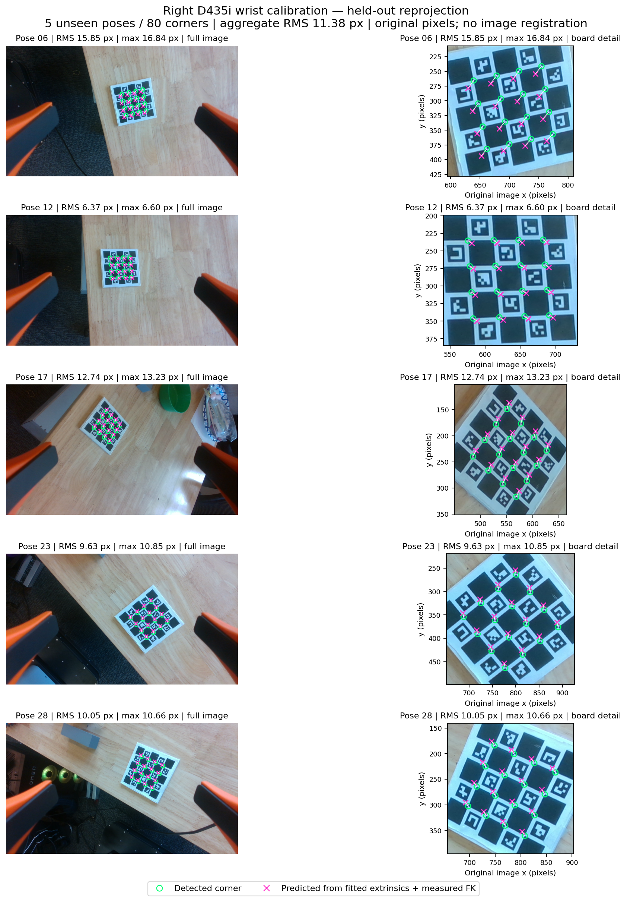

# Saved robot camera parameters

The current parameter snapshot is
[`camera_parameters_20261008.json`](../config/camera/camera_parameters_20261008.json).
It records the head and both wrist estimates, SDK intrinsics, physical board
scale, frame identities, measured-joint mapping, provenance and validation
numbers. [`cameras.json`](../config/camera/cameras.json) points to this snapshot.
The [latest wrist results](wrist_parameters_20261008.md) document both measured
fits, their numerical reproduction and their remaining errors. The detailed
2026-10-06 results below describe the retained
[`camera_parameters_20261006.json`](../config/camera/camera_parameters_20261006.json)
snapshot; its left-camera `null` entries are historical, not the current export.
All paths inside the snapshot are relative to the repository's `calibration/`
directory. The original fit reports retain their original local provenance paths;
those paths are not required to load the matrices.

| Camera | Serial | Fixed transform: source → destination | Saved estimate |
| --- | --- | --- | --- |
| Head ZED 2i, short 40° mount | `32701991` | Rectified LEFT optical → moving lift `maver_x4_asm_URDF_link_1` | [Head landmark fit](../config/camera/zed_landmark_candidate_20260930.json); [coarse board fit](../config/camera/zed_candidate_20260930.json) retained separately |
| Right D435i, outside 33° mount | `243222074562` | Native RGB color optical → wrist/flange `maver_x4_asm_mount2` | [Latest right wrist fit](../config/camera/realsense_d435i_right_candidate_20261008.json) |
| Left D405, outside 32° mount | `230422271628` | Color optical → wrist/flange `maver_x4_asm_mount1` | [Left wrist fit](../config/camera/realsense_d405_left_candidate_20261008.json) |

The head estimate remains provisional; the right fit is a candidate. Saving
parameters does not change the production camera selection, convert validation
annotations into runtime interlocks, or label CAD geometry as a physical fit.
The production right-wrist observation separately selects its configured candidate;
this parameter export does not switch that runtime configuration. Both new wrist
fits remain candidates. Neither the left mount nor its intrinsics are inferred
from the right D435i.

## Transform direction, units and TCP

`T_destination_from_source` maps a homogeneous source point into destination
coordinates using column vectors:

```python
p_destination = T_destination_from_source @ p_source
# T[:3, :3] = rotation; T[:3, 3] = translation in meters
```

Optical axes are **X right, Y down, Z forward**. Matrices are 4 × 4 with last row
`[0, 0, 0, 1]`. Intrinsics are in pixels at the recorded image resolution.
The URDF/IK base is **`maver_x4_asm_maver_x4_base_link`**, not a world/map frame
and not the MuJoCo gripper body named `robot_base`.

The snapshot's common key is **`T_parent_from_optical`**. Original head reports
call it `T_mount_from_camera`; the right report calls it `T_wrist_from_camera`
and also contains the identical `T_parent_from_optical` alias. These matrices
map camera points **into the robot parent**, rather than projecting robot points
into the camera. Invert them for the opposite direction.

The saved right-wrist matrix is **camera → wrist/flange, not camera → TCP**.
A TCP is a separate tool frame configured by the controller. Its offset was not
estimated by this calibration. Compose the actual configured tool transform:

```text
T_TCP_from_camera = inverse(T_wrist_from_TCP) @ T_wrist_from_camera
T_camera_from_TCP = inverse(T_TCP_from_camera)
```

Do not assume that the flange and fingertip center coincide or apply a second
TCP offset to a transform already expressed in TCP coordinates.

## Camera pose in the robot base

Use synchronized **measured** lift and arm joint positions to compute FK:

```text
Head:
T_base_from_camera(q) = FK_base_from_lift(q) @ T_mount_from_camera

Right wrist:
T_base_from_camera(q) = FK_base_from_right_wrist(q) @ T_wrist_from_camera

Either calibrated camera:
p_base = T_base_from_camera(q) @ p_camera
```

The camera-to-parent matrix is constant while the rigid installation stays
unchanged. Camera-to-base changes with lift height; wrist camera-to-base also
changes with arm angles. The example `T_base_from_camera_at_captures` matrices in
the historical head report apply only to those recorded lift heights. They are
not constant extrinsics for runtime use.

The `robot_reference` section preserves the **both_j6** convention used for FK:

```text
q_model = signs * q_sdk[sdk_indices] + offsets_rad
SDK indices, both arms: [0, 1, 2, 3, 4, 5, 6]
Signs, both arms:       [1, 1, -1, 1, -1, -1, -1]
J1 offset: left +pi/2; right -pi/2; other offsets zero
```

The URDF carries the distinct left/right installation transforms. Saved legacy
model `q` layout is base X/Y/yaw, lift, left J1–J7, right J1–J7. The first three
coordinates are not physical joint encoders or measured world localization.
Angles are radians and lift displacement is meters. The public mapping is a
reference for semantics; local controller endpoints/research bindings are not
part of this parameter export. Changing signs, zero offsets, tool geometry or
robot model requires checking calibration consistency again.

## Intrinsics and internal camera transforms

These values were read from the actual SDK stream; they were **held fixed** while
solving robot extrinsics.

| Parameter | Head rectified LEFT | Right native RGB color |
| --- | --- | --- |
| Resolution | 1920 × 1080 | 1280 × 720 |
| `fx`, `fy` | 1055.28076171875, 1055.28076171875 | 909.8963623046875, 909.7846069335938 |
| `cx`, `cy` | 980.4390869140625, 559.5460815429688 | 643.9840698242188, 373.11004638671875 |
| Saved distortion | `[0, 0, 0, 0, 0]`, rectified image | `[0, 0, 0, 0, 0]`, native color profile |
| Right capture rate | — | 30 FPS |

`K = [[fx, 0, cx], [0, fy, cy], [0, 0, 1]]`. Coarse head calibration used
slightly different per-session intrinsics; retain its report's values when
reproducing that fit. Query the SDK for a different stream resolution/profile;
do not use the full-resolution K with resized/cropped preview pixel coordinates.
Any explicit resize or crop must transform K and pixels consistently.

The D435i reported native `inverse_brown_conrady` with **zero coefficients**;
its saved processed model is `none`. Nonzero inverse-Brown coefficients cannot
be passed directly to OpenCV's forward-Brown projector. Preserve the recorded
stream/pixel convention or rectify through the SDK before fitting.

The head transform refers to the **LEFT lens optical frame**, not the housing
center or stereo midpoint. A numerical LEFT↔RIGHT factory stereo transform is
not included in the recorded fit. Likewise, this right-wrist result contains no
numeric depth intrinsics or factory depth-to-color transform. These unavailable
fields are explicit in the snapshot. Obtain the appropriate SDK profile's
factory transforms before composing RIGHT-lens or native-depth geometry. This
robot calibration solves RGB optical pose; it does not recalibrate camera stereo
geometry, depth scale or the camera IMU.

## Board and calibration equations

[`charuco_87mm.json`](../config/camera/charuco_87mm.json) describes the actual
print: 5 × 5 squares, **87 × 87 mm patterned area**, **17.4 mm squares**, 11.6 mm
markers, `DICT_4X4_50`, marker IDs 0–11 and 16 internal corners. The backing is
100 × 100 mm. Use the patterned area for metric coordinates, not the backing.
Marker size/white margin assume uniform print scaling; measurement uncertainty
has not been quantified.

For the head, a rigid board was attached to the hand:

```text
X @ C_i = G_i @ Y
X = T_lift_from_camera              (fixed camera estimate)
G_i = T_lift_from_hand(q_measured)   (measured-joint FK)
C_i = T_camera_from_board           (image PnP)
Y = T_hand_from_board               (fixed board attachment)
```

The coarse fit estimates X and Y jointly, using a Park initialization and robust
gradient descent. The later head refinement fits X with manually matched left-arm
landmarks and fixed measured-FK/CAD anchors. See the
[head procedure](camera_calibration.md) for both stages and model limitations.

For the wrist, the board stayed on the table while the camera moved with the hand:

```text
G_i @ X @ C_i = Y
G_i = T_base_from_wrist(q_measured)  (measured-joint FK)
X = T_wrist_from_camera             (fixed camera estimate)
C_i = T_camera_from_board           (image PnP)
Y = T_base_from_board               (stationary board during acquisition)
```

The right report's **`T_base_from_board`** is a second fitted constant; it is not
camera-to-base or board-to-hand. It describes the particular table-board placement
in that run and is not a permanent robot parameter. The shared solver uses Park
initialization plus joint pseudo-Huber gradient descent with Armijo line search.
Position/angle residual scales were 0.002 m / 0.01 rad; these are optimizer scales,
not demonstrated calibration accuracy. See the
[wrist procedure](realsense_wrist_calibration.md) for collection and the correct
outside-right mount.

## Right-wrist result and held-out evidence

Physical source run: `20261006T212257.169425Z`, October 6, 2026.
Thirty poses were attempted; **27 captures** were eligible. The fit used 22 poses;
**6, 12, 17, 23, 28** were held out and never used to fit either X or Y.
The original fit JSON was copied byte-for-byte, preserving its source hashes,
matrices, method and original validation annotations.

| Held-out pose | Reprojection RMS, pixels | Maximum, pixels |
| --- | ---: | ---: |
| 6 | 15.85 | 16.84 |
| 12 | 6.37 | 6.60 |
| 17 | 12.74 | 13.23 |
| 23 | 9.63 | 10.85 |
| 28 | 10.05 | 10.66 |
| All 80 corners | **11.38** | **16.84** |

Held-out closure RMS is **5.35 mm / 2.31°**. Training position closure RMS is
12.94 mm, with a maximum 34.40 mm; robust fitting retained and downweighted the
outliers rather than treating them as ground truth. Closure is consistency of
board poses, not independent error against known camera extrinsics.



Green circles are detected corners; magenta crosses are predictions. Full views
are on the left and enlarged board regions on the right. Predictions use
`inverse(X) @ inverse(G_i) @ Y` and the recorded K/distortion; they do not use the
held-out image's PnP matrix for reprojection. No refitting, image registration or
visual alignment was applied. Visible offsets remain.

The solver converged and saved this candidate before the subsequent automatic
return failed its arm-arrival check. The run-level `passed: false` therefore
records that later control failure; it does not erase the saved fit. Neither
`converged: true` nor successful capture alone establishes physical accuracy.
The [capture summary](../artifacts/reference/wrist-calibration-20261006/capture-summary.json)
retains the finish reason and split. The head's historical inlier RMS is 3.25 px,
all-point RMS 11.93 px and leave-one-pose-out RMS 14.94–16.79 px; its original
`calibration_accepted: false` annotation remains unchanged.

## Load and reproduce without robot access

From this repository root:

```python
import json
from pathlib import Path
import numpy as np

root = Path('calibration')
parameters = json.loads((root / 'config/camera/camera_parameters_20261008.json').read_text())
camera = parameters['cameras']['right']  # 'head' and 'left' also have saved estimates
T_wrist_from_camera = np.asarray(camera['T_parent_from_optical'])
K = np.asarray(camera['intrinsics']['K'])
# Use your measured-joint URDF FK; this is not a constant world/base pose:
# T_base_from_camera = T_base_from_wrist_measured @ T_wrist_from_camera
```

The portable [numerical wrist dataset](../artifacts/reference/wrist-calibration-20261006/dataset.json)
contains all 30 eligibility records, measured q/FK, PnP, raw corner coordinates
and camera metadata. It excludes raw room photographs and device health/control
logs. The committed comparison figure is archived output; its original raw
images remain in the ignored source run. Numeric projections can be reproduced
without those images. Original source and compact-export hashes are distinguished.

```bash
# Numerical refit (new output; the committed candidate is not overwritten):
./scripts/calibrate_camera.sh right fit \
  calibration/artifacts/reference/wrist-calibration-20261006/dataset.json \
  --output /tmp/right-wrist-refit.json

# Verify saved transforms, metadata and held-out numerical projections:
OMP_NUM_THREADS=1 OPENBLAS_NUM_THREADS=1 MKL_NUM_THREADS=1 \
  PYTEST_DISABLE_PLUGIN_AUTOLOAD=1 ../../.venv/bin/python -m pytest -q \
  -c calibration/pytest.ini calibration/tests/calibration/test_saved_parameters.py
```

When replacing estimates, preserve versioned fit reports and original annotations,
record the camera serial/mount/stream/robot mapping, and update the parameter
snapshot and camera registry together. A changed camera installation requires a
new fit. Selecting this snapshot in an application is a separate configuration
change; this export does not rewrite the parent's runtime sensor configuration.
