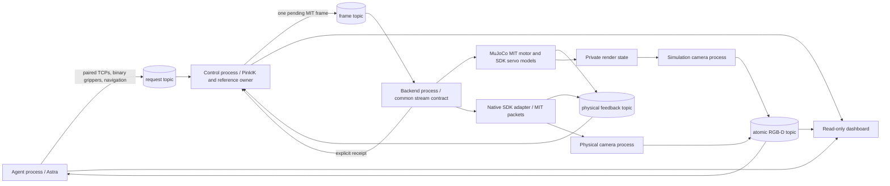

> Current ownership (2026-10-14): controller, device transport, process/topic runtime and robot resources are owned by this repository. Neither former solver/runtime repository is required. See [ownership](ARCHITECTURE_OWNERSHIP.md) and [standalone setup](STANDALONE.md).

# Shared control and actuation

## Shared implementation

Both backends run the same `ControlComponent`, `BackendComponent`,
`StreamContract`, `ReferenceOwner`, paired-pose executor and owned
`PinkIKCore`. The shared deployment YAML supplies robot geometry, MIT gains and
effort assumptions, per-joint velocity limits, lift speed and calibration.
Control receives robot-only metadata, never the scene configuration or root pose.

Each command frame contains sequence, creation time, physical joint positions
and velocities, the MIT position/velocity/feedforward/gain vectors, body-frame
base velocity and binary gripper commands. Feedback carries physical encoder and
gripper state plus the original per-device receipt timestamps. Serialization and
command admission are common to both adapters.

MuJoCo evaluates the arm motor law
`tau = clip(kp*(q_ref-q) + kd*(v_ref-v) + torque_ff, effort_limits)`.
It does not assign commanded arm positions to the plant state. The native adapter
maps the same MIT values into the SDK's motor commands. Model torque saturation
is explicit; native firmware does not expose a matching programmable total-effort
clamp in this MIT packet. Simulated and real dynamics are therefore not identical.
New runs save both configured `plant.xml` and compiled `plant.mjb`, including MIT
gain/bias terms, disabled position-input clamps, lift force limits and zero body
gravity compensation. Export tests reload both models and check actual torques;
the original scene's position-servo template is not the exported actuator model.

The shared reference owner allows one unresolved frame. PinkIK commits its history
before returning; the owner prevents another solve until an explicit receipt
arrives. Unknown/rejected publication faults the session without resetting to
measurement or fabricating acceptance. Native receipts cover all primary device
groups, not just one arm. A receipt means command publication/application at the
reported scope, not physical target arrival. A last pending frame can be canceled
at shutdown; generated and accepted counts are deliberately reported separately.

## Scheduling and shared memory

The owned `hexfellow_deploy.runtime` package provides `DAManager`, `DABaseInterface`,
`ArrayCommWrapper`/`DASHMComm`, Hydra construction and the YAML topic registry.
The historical class prefixes retain source lineage; there is no external package import.
Topics are named shared-memory arrays with semaphores and coherent latest-value
snapshots. There is no unbounded command FIFO. RGB-D uses one binary publication
with the corresponding physical encoder metadata.

Control feedback, MIT references, measured proprioception and actuator receipts
now use fixed float64 layouts rather than JSON-filled 64 KiB arrays. Backend
diagnostic JSON publishes at 10 Hz plus lifecycle transitions. Numeric channels
use bounded semaphore waits and preserve source timestamps on retries. This is
alignment of selected DA mechanisms, not identical YAM recovery behavior; see
the explicit [alignment audit](DEPLOY_ANYTHING_ALIGNMENT.md).

The manager's empty staged cycle is replaced with a cooperative wait on DA stop
flags. Independent interface processes own control, device streaming, camera,
policy and dashboard clocks. This intentionally uses DA's lifecycle and transport
without placing image rendering or remote inference behind the 50 Hz control
barrier. The device SDK and feedback builder keep their independent workers.

Control waits only the remaining period:
`max(0, cycle_started + period - now)`. Work overruns warn; they do not add a fresh
20 ms sleep or create a catch-up burst of IK solves. Acceptance waits appear in
interval/handoff metrics. PinkIK remains the only joint trajectory integrator;
no second DA joint interpolator was added. The lift and gripper inner servos model
the hardware SDK's actuator behavior rather than a second arm trajectory planner.

## Native adapter boundary

The new native driver reuses calibrated mappings, packet encoders, ownership
acquisition, health checks, GP80 integer endpoint handling and stop confirmation
from the existing endpoint. It does not instantiate the old gateway supervisor or
its command/feedback mailbox runtime. A finite `ContinuousGate` replaces the old
source-feedback-derived 40 ms authorization rule, while retaining payload matching,
sequence checks, disallowed automatic rearm/clear-stop rejection and checked
transport handling of expired retransmissions. Publication failure remains distinct
from physical stop-confirmation failure.

Startup constructs the controller and publishes its initialization state before
native acquisition. It then shares the acquired measured seed rather than opening
multiple control sessions. Native and simulation cameras publish the same
registered metric depth/physical feedback contract. Physical extrinsic calibration
remains provisional as documented in the parent workspace.

Physical camera capture remains at 15 Hz. Its process samples the existing
feedback SHM independently at 250 Hz into a bounded encoder history and pairs each
new image with the closest recorded host receipt timestamp. Original timestamps
and encoder values are preserved; no interpolation or synthetic time refresh is
used. A metadata-only poll avoids another full camera-period delay and retries
transient SHM contention promptly. Fresh candidate publication precedes evaluation
of the previous publication gap. The 250 ms image-age and 80 ms matching limits
remain unchanged. `camera_health.json` records ages, skew, rejection counts and
bounded recent publication timings independently of the control process.

## Timeouts

| Condition | Shared response |
|---|---|
| Compute exceeds its 6 ms budget | Record warning; continue with remaining-period sleep |
| Work exceeds the 20 ms control period | No extra fixed sleep and no speculative catch-up solves |
| Application delayed 30 ms | Wait for the actual receipt; do not advance PinkIK again |
| Command source stops updating for configured 100 ms | Fault and stop the stream |
| Actual device feedback stale for configured 100 ms | Fault independently of command freshness |
| Upstream strict sensor age exceeds 40 ms or coupled-device skew exceeds 20 ms | PinkIK rejects the feedback independently of the 100 ms stream watchdog |
| Reference SHM semaphore busy for 1 ms | Retry the exact pending frame within the existing finite health deadline; never re-solve or retimestamp |
| Persistently unavailable or unknown/partially failed publication, or device ownership loss | Fault; do not automatically rearm |
| Inference is slow or returns an error | Control continues independently; show the policy error |
| Observation is stale or posture changed during inference | Reject that target and request a new observation |
| Final diagnostic HOLD requested | Stop new policy targets, complete constrained braking and record final state |

The old command's feedback age does not determine the new stream's liveness.
Command creation time and actual feedback receipt clocks are checked separately.
These finite values are software configuration, **not a measured hardware stopping
envelope**. Real devices, operating-system scheduling and networks still require
onsite qualification. The upstream PinkIK motion profile retains its own feedback,
reference, acceleration, jerk and effort constraints. Not every IK failure is a
scheduler warning, and simulator-only passing tests cannot justify ignoring it.
In particular, the adapter still selects upstream `feedback_policy="strict"`:
per-device timestamps must be at most 40 ms old and span at most 20 ms. These
sensor-clock checks are separate from the 100 ms watchdog measured from command
creation. Simulation publishes one coherent physics snapshot with equal group
timestamps, so its passing delay cases do not validate asynchronous hardware
sensor delivery or prove that a real session will satisfy the upstream checks.

## Plant assumptions and qualification boundary

The lift accepts the same SDK-style position request with the configured speed
limit. The simulation leaf uses a position-to-bounded-velocity inner PI force
servo, implicit velocity damping and a finite 1800 N assembly force limit. Integral
feedback rejects unknown carried loads; it is not given object identity or mass.
Both the actuator and joint force clamps use that explicit assembly limit; the
source URDF's placeholder 10 N clamp cannot support the robot's lift gravity.
The inner gains are modeling assumptions, not identified firmware gains.

The base remains a planar velocity-servo approximation, not a wheel/traction model.
Binary GP80 commands map to finite-travel contact jaws in MuJoCo and calibrated
motor endpoints on hardware. Neither this jaw model nor idealized camera rendering
establishes physical grasp reliability. Simulator root/object state and contact
scoring stay private to the plant, renderer and post-run evaluator.

The common runtime and MIT frame contract are implemented and exercised in
simulation. Physical sensor timing, sustained MIT publication, partial transport
failures, real gains, gripper contact force and stopping still require hardware
validation. No hardware qualification is claimed by this migration.
