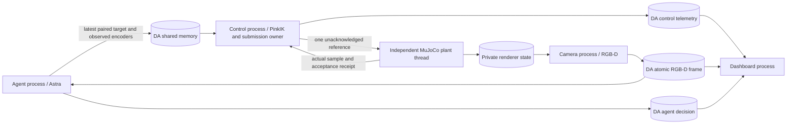

# Runtime boundary and migration status

## Implemented

The exact DA components reused are `DAManager`, `DABaseInterface`,
`ArrayCommWrapper`/`DASHMComm`, the YAML topic registry, topic resolver and Hydra
instantiation. Topics are actual named shared-memory arrays guarded by DA's
named semaphores. Readers obtain a coherent latest publication, not an unbounded
FIFO. Bounded JSON is used for low-rate control requests/diagnostics; RGB-D uses
one binary array with encoder metadata from the same plant snapshot.

The manager subclass only replaces its empty staged pipeline loop with a
cooperative wait on DA component stop flags. Control, rendering and network
inference have different clocks, so they are independently clocked DA interfaces,
not inference/output stages behind one shared cycle barrier. DA itself supplies
process creation, affinity/priority requests, shared-memory lifecycle and cleanup.
This is an explicit deviation from DA's synchronized staged scheduling mode.

At 50 Hz, the control owner reads actual feedback, consumes the newest target,
solves once and submits one reference. Its remaining sleep is
`max(0, cycle_start + period - now)`. A compute-budget overrun records a warning;
there is no catch-up burst of speculative IK steps. Acceptance waits are measured
in the interval and handoff metrics rather than hidden in compute time.

PinkIK owns all joint reference integration and constrained braking. There is
no second joint interpolator. PinkIK currently commits its internal reference
before returning. `ReferenceOwner` prevents the next solve until the previous
submission has an explicit receipt. A rejected/unknown submission latches the
session fault; it never fabricates acceptance or resets to measured positions.
Receipts distinguish simulator application, SDK acceptance and UDP submission.
None means that the hardware reached the reference.

The simulator's actuator worker runs independently. Its position actuators are
not physical MIT torque loops. Feedback timestamps are generated at actual
sampling; delayed camera publication does not refresh the encoder timestamp.
Simulator base/object state is available only to the plant and renderer, never
to policy/control observations. The policy receives RGB-D, physical joint/gripper
feedback and robot-only FK. Navigation XY/yaw remains policy output.

## Timeout semantics

| Condition | Current simulator behavior |
|---|---|
| Compute exceeds 6 ms budget | Warning; next cycle after remaining sleep |
| Work exceeds 20 ms period | Warning; no extra fixed sleep or catch-up burst |
| Submission takes 30 ms | Wait for receipt; no additional IK solve |
| Actual feedback or acceptance unavailable for 100 ms | Fault this control session; keep diagnostic service available |
| Inference is slow or errors | Control continues independently; API error is displayed |
| Target's observation expired/posture changed | Reject that target and reobserve |
| Operator closes the run | Stop components and preserve final reports |

The 100 ms simulator health limit is not a reviewed hardware stopping envelope.
No duration value from this simulator config may silently become a native MIT
watchdog. The previous `min(source_feedback)+40 ms` gateway authorization scheme
is absent from this runtime; removing it from an actual hardware deployment
still requires implementing and validating the native adapter below.

## Native MIT work not yet implemented

1. Implement one native DA hardware owner using the existing calibrated mappings,
   MIT encoding, binary GP80 commands and SDK ownership/health semantics. Replace
   the old gateway dispatch/authorization loop, rather than wrap it under a new name.
2. Keep feedback sampling and SDK publication independent of network inference.
   Give each accepted reference an explicit publication receipt. Define what a
   partial group submission means; never acknowledge an all-device transaction
   when only one arm was submitted.
3. Separate host cycle warnings from command-source loss and real device faults.
   Define the finite native hold/brake behavior from measured device behavior and
   a trajectory timing contract. Do not turn a compute warning into automatic
   rearm, clear-stop, indefinite old-velocity streaming or a fake feedback refresh.
4. Resolve delayed-step MIT semantics. Current profile-bound PinkIK rejects
   variable `dt`; a 30 ms delayed cycle cannot simply be passed as `dt=.03`.
   Position-plant convergence does not validate the commanded MIT velocity,
   acceleration or torque during that gap. Test accepted reference history,
   missed-cycle hold/brake and resumption before enabling native motion.
5. Port the physical RGB-D adapter and actual per-device receipt timestamps.
   Keep telemetry/visualization outside the publication path. Reproduce startup,
   delayed feedback, partial writes, session loss and lift stop confirmation.
6. Only then qualify continuous native MIT, base/lift/binary grippers and policy
   execution onsite. Add upstream changes on UMI `zi/dev_camera`, with a separate
   commit/push and parent pin update if needed.

This initial migration deliberately does not rewrite UMI's reference internals,
change existing robot release bindings or claim that historical hardware errors
have been fixed. The simulator and hardware qualification boundaries remain explicit.
