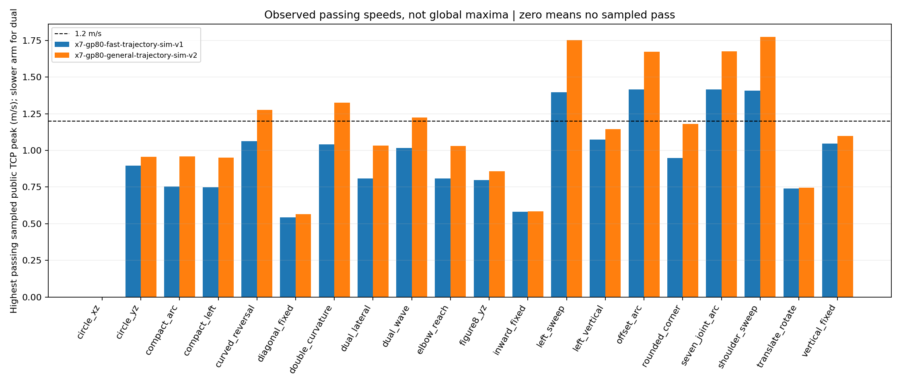
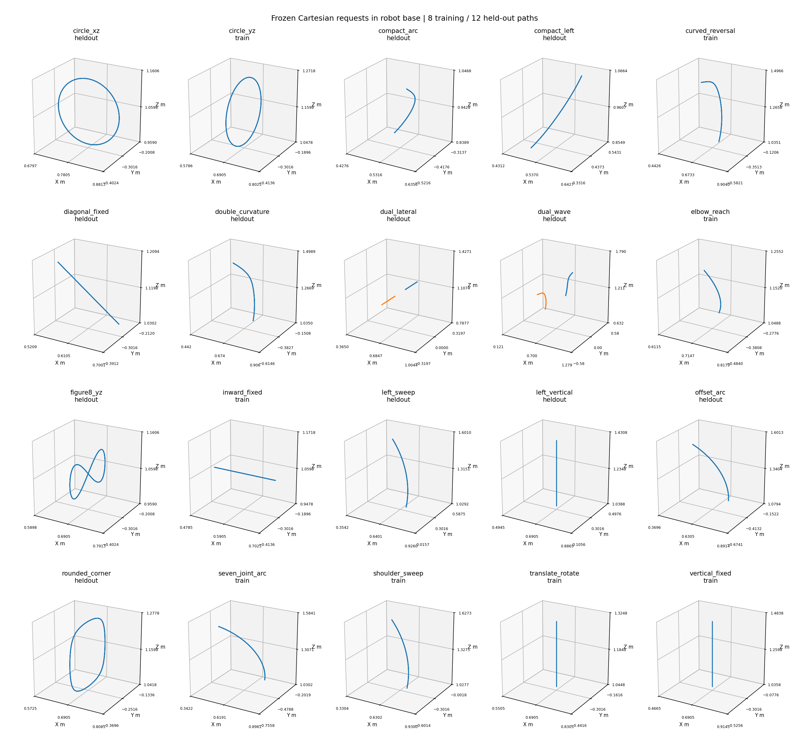

# General trajectory IK experiments

The frozen simulation candidate reaches **1.774 m/s at the public pad-center
TCP** on a shoulder sweep, with **3.056 mm position RMS** and **0.579 degrees
orientation p95**. The previous profile reaches 1.407 m/s on the same path in
this sweep. This is a 26.1% increase in the highest passing sampled peak, not a
global speed bound or a guarantee for arbitrary Cartesian motion.

All work remains on `feat/ik-1p2mps-benchmark`, based on `e4a2085`, in an isolated
worktree. The billiards branch remains intact. Hardware and interactive defaults
are unchanged. No robot endpoint was opened.

## Path coverage and selection

The catalog contains 20 paths, split before tuning into 8 training and 12 held-out
paths. It includes single-arm left/right and simultaneous dual-arm motion;
extended, perturbed and compact initial postures; fixed-orientation lines,
circles, figure eights and rounded corners; translation plus rotation; and
seven-joint FK-generated paths with different curvature and reversals.
Every motion includes an initial hold, smooth start/stop and a final hold.

Joint-space constructions are offline target generators, not joint commands.
The public IK adapter receives only Cartesian poses and body derivatives.
The target generator's joint positions never enter controller feedback, posture
references, or optimization. Cartesian-only tests do not assume reachability.

The training search recorded 256 simulations. Cost sweeps, velocity feedback,
normalized tasks, and the optional measured-pose controller were compared. The
measured-pose variants regressed several paths and were not selected. The final
profile was frozen before held-out simulation. Its selection and hashes are in
[the freeze record](validation/general_ik_20261016/frozen_selection.json).

The original research identifier `circle_xy` was incorrect: its saved rotation
basis generates an XZ circle. The canonical catalog now calls it `circle_xz`.
Only its name changed; numeric geometry and results were retained. Exported
records keep the original identifier for traceability.

## Controller changes and ablations

`x7-gp80-general-trajectory-sim-v2` selects the existing normalized position/SO(3)
objective rather than the coupled SE(3) translation residual. Its scalar cost
multipliers are position 1.04, orientation 2.1 and normalized acceleration 0.04.
These must not be compared directly with legacy cost numbers: position and
orientation residuals are normalized by 5 mm and 2 degrees, and acceleration
by the configured joint acceleration limits. Feedback gain remains 0.2.

The Cartesian request envelope changes from 1.5/8/120 to **2/12/240** in m/s,
m/s² and m/s³; angular limits change from 3/14/160 to **4/20/320** in rad/s,
rad/s² and rad/s³. The hard joint position, speed, acceleration and jerk limits,
MIT kp/kd, torque ceilings, source freshness and braking requirements remain
unchanged. The lift remains locked at 0.3 m and the base remains fixed.

Most peak-speed improvement comes from allowing a wider target envelope.
It should not be attributed entirely to an IK algorithm change. At identical
candidate target speeds, an envelope-only ablation passes the shoulder sweep,
dual wave, double-curvature and compact-left cases. It fails the seven-joint
arc's position-p95 gate and the vertical, left-vertical and YZ-circle orientation
gates; the normalized candidate passes all eight. This isolates a useful task
weighting/geometry improvement beyond increasing a speed cap. Some position
errors increase while orientation errors decrease; every acceptance gate must
still pass.

The shared derivative improvements from the billiards branch are available for
explicit comparisons: analytic target acceleration and opt-in measured velocity
error feedback. The selected general candidate uses persistent-reference
tracking with measured velocity feedback, not the optional measured-pose law.
It leaves source-acceleration and measured-error-derivative gains at zero.

## Observed passing speeds

19/20 paths have a passing sampled speed, including **11/12 held-out paths**.
Each path uses the same frozen controller. Only the offline trajectory duration
changes. The table reports public pad-center TCP peak speed; for dual-arm motion
it reports the slower arm's peak. Each moving arm independently passes the
error criteria. Faster failed samples remain in the evidence.

| Path | Split | Previous peak m/s | Candidate peak m/s | Candidate RMS mm |
|---|---|---:|---:|---:|
| circle_xz | heldout | — | — | — |
| circle_yz | train | 0.896 | 0.956 | 2.724 |
| compact_arc | heldout | 0.754 | 0.959 | 1.522 |
| compact_left | heldout | 0.748 | 0.950 | 1.475 |
| curved_reversal | train | 1.062 | 1.276 | 1.834 |
| diagonal_fixed | heldout | 0.543 | 0.565 | 1.155 |
| double_curvature | heldout | 1.042 | 1.326 | 2.145 |
| dual_lateral | heldout | 0.809 | 1.034 | 2.044 |
| dual_wave | heldout | 1.016 | 1.225 | 2.111 |
| elbow_reach | train | 0.808 | 1.031 | 2.002 |
| figure8_yz | heldout | 0.797 | 0.858 | 3.205 |
| inward_fixed | train | 0.582 | 0.583 | 3.229 |
| left_sweep | heldout | 1.396 | 1.754 | 2.942 |
| left_vertical | heldout | 1.074 | 1.144 | 2.540 |
| offset_arc | heldout | 1.416 | 1.674 | 4.136 |
| rounded_corner | heldout | 0.949 | 1.181 | 2.766 |
| seven_joint_arc | train | 1.415 | 1.676 | 3.812 |
| shoulder_sweep | train | 1.407 | 1.774 | 3.056 |
| translate_rotate | train | 0.741 | 0.746 | 1.402 |
| vertical_fixed | train | 1.047 | 1.100 | 3.054 |





These are sampled passing speeds, not proven fastest paths. The search first
screens Cartesian derivative limits with a 5% time-scaling reserve, then tests
MIT tracking, halves failed speeds and bisects a local pass/fail interval to
0.04 m/s requested-speed resolution. Several paths pass the screened ceiling;
they have no observed failure immediately above it. Bisection assumes local
monotonicity and does not establish global optimality. Requests and achieved
speeds are recorded separately; slowing a path is never counted as executing
the original requested speed.

The fixed-orientation XZ circle fails even at 0.2 m/s in both profiles. A separate
five-start bounded nonlinear endpoint check leaves up to 55.3 mm position and
3.49 degrees orientation residual at sampled points. This supports a workspace/
orientation limitation, but finite local optimization does not prove global
unreachability. It is retained as a failure, not removed from the catalog.

## Acceptance and limitations

Acceptance is unchanged: each moving arm needs position RMS <=5 mm, position
p95 <=10 mm, orientation p95 <=2 degrees and final position error <=1 mm, plus
all checked joint constraints, no planner failure, no modeled contact and no
modeled torque saturation. No time shift or fitted alignment reduces error.
The fast-duration gate separately requires at least 0.1 continuous seconds above
1.2 m/s on each moving arm; a passing peak alone does not establish that gate.

The nominal fastest sample reproduces exactly for position metrics, speed
metrics and acceptance. **All eight +/-10% mass/inertia checks fail the final
1 mm position gate**, with final errors around 1.94–2.65 mm. Their motion RMS,
orientation, limits and other gates still pass. Nominal inertia feedforward is
not robust physical calibration. This profile is not ready to claim comparable
hardware tracking, and no physical run was performed.

TCP metrics are sampled at the 100 Hz control timestamps. Contacts and torque
saturation are audited at every physics step. Self-collision avoidance remains
disabled in the inherited profile, so contact checks do not establish complete
mesh clearance. Deterministic stepping bypasses IPC/network/scheduling jitter;
parallel wall-clock timing is not realtime qualification. The final position
gate also does not guarantee zero holding jitter.

## Reproduce

From the standalone repository with its simulation environment installed:

```bash
OMP_NUM_THREADS=1 OPENBLAS_NUM_THREADS=1 .venv/bin/python \
  -m hexfellow_deploy.benchmark.run \
  --profile robot_resources/config/control/motion_profiles/x7-gp80-general-trajectory-sim-v2.yaml \
  --trajectory-spec configs/benchmarks/generalization/shoulder_sweep.json \
  --speed 1.805 --derivatives \
  --output "runs/general_sweep_$(date +%Y%m%d_%H%M%S)"
```

To reproduce the complete frozen profile's per-path speed search:

```bash
OMP_NUM_THREADS=1 OPENBLAS_NUM_THREADS=1 .venv/bin/python \
  -m hexfellow_deploy.benchmark.general_speed_search \
  --profile robot_resources/config/control/motion_profiles/x7-gp80-general-trajectory-sim-v2.yaml \
  --split all --max-speed 1.9 --resolution .04 --jobs 1 \
  --output "runs/general_search_$(date +%Y%m%d_%H%M%S)"
```

Use `--split train` for tuning and `--split heldout` only after freezing a
candidate. `general_suite` runs a fixed speed grid and accepts repeated
`--profile` flags; `--retime` records any Cartesian-envelope slowdown. Omitting
`--retime` runs the requested speed unchanged, including intentional stress
failures. Neither workflow overwrites old run directories.

`general_report --manifest <baseline/manifest.json> --manifest <candidate/manifest.json>
--output <new-report>` exports plots and compact evidence.
`MUJOCO_GL=egl .venv/bin/python -m hexfellow_deploy.benchmark.general_video <new-report>`
replays four passing saved simulations at 1x. Replays load recorded plant states;
the underlying control experiments use the shared MIT dynamics, never target
joint teleportation.

## Verification and artifacts

The deployment suite passes **483 tests, 1 skipped**, in 79.35 seconds. Tests
include independent finite-difference derivatives and endpoints for all 20
paths, left-only envelope screening, per-arm rather than pooled error admission,
existing shared simulation and standalone import rejection.

[Validation index](validation/general_ik_20261016/validation.json) records source
hashes, every path's speed bracket, test counts and limitations.
[Training evidence](validation/general_ik_20261016/training.json) retains unsuccessful
parameter choices. [Final checks](validation/general_ik_20261016/final_checks.json)
retain matched-speed ablations, model-mismatch failures and the repeat run.
Raw traces, commands and compiled plants remain under
`runs/general_search_20261016/` in the development worktree.

The local environment reuses installed scientific dependencies and an unchanged
native kernel; this is not a clean-install validation. No default configuration,
main branch, hardware release binding or consuming application was modified.
