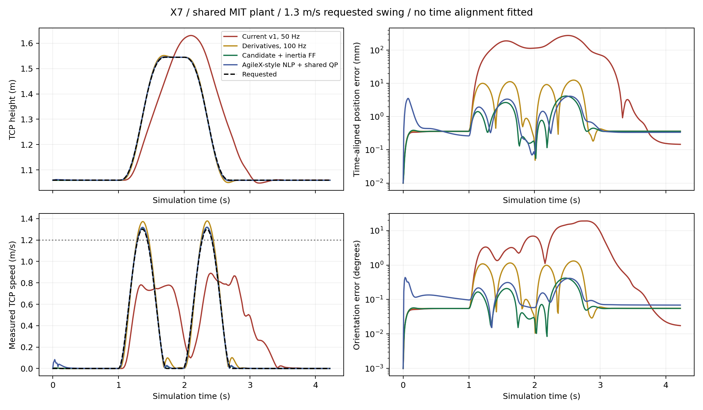
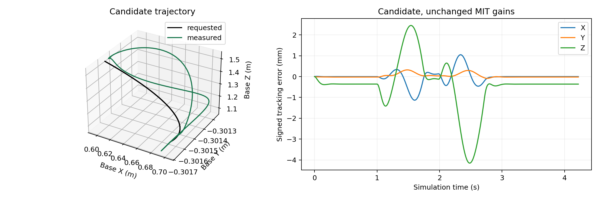

# Fast X7 IK benchmark

The October 16, 2026 experiments support keeping the constrained differential IK
and improving its trajectory inputs and feedforward. At the public pad-center
TCP, the candidate reaches 1.284 m/s with 1.938 mm position RMS. At the core
fingertip TCP, it tracks a reachable 1.3 m/s swing with 1.990 mm position RMS,
4.021 mm position p95, and 0.404 degrees orientation p95; measured peak is
1.317 m/s. A path
that moves all seven joints also passes when its Cartesian acceleration and jerk
fit the configured envelope. This is not a claim that every Cartesian path can
run at 1.3 m/s.

The work is on `feat/ik-1p2mps-benchmark`, based on `85cdb90`. Hardware defaults
remain unchanged. No physical device was opened for these experiments. The new
profile is explicitly an uncommissioned simulation candidate.

## Reproduce

Use this repository alone. From its root, install the normal simulation
environment if needed, then the optional nonlinear benchmark dependency:

```bash
./scripts/setup_sim.sh
uv pip install --python .venv/bin/python --no-build-isolation -e '.[benchmark]'
```

The first command creates the Python 3.10 environment; an existing working
environment does not need to be recreated. CasADi 3.6.7 is optional for the
nonlinear comparison and the complete suite. The differential IK benchmark does
not import it.

Run the candidate on a reachable Cartesian swing:

```bash
OMP_NUM_THREADS=1 OPENBLAS_NUM_THREADS=1 .venv/bin/python \
  -m hexfellow_deploy.benchmark.run \
  --profile robot_resources/config/control/motion_profiles/x7-gp80-fast-trajectory-sim-v1.yaml \
  --posture extended --trajectory swing --speed 1.3 --derivatives \
  --output "runs/fast_ik_$(date +%Y%m%d_%H%M%S)"
```

Run both arms through the multi-joint Cartesian path:

```bash
OMP_NUM_THREADS=1 OPENBLAS_NUM_THREADS=1 .venv/bin/python \
  -m hexfellow_deploy.benchmark.run \
  --profile robot_resources/config/control/motion_profiles/x7-gp80-fast-trajectory-sim-v1.yaml \
  --posture extended --trajectory joint_curve --distance 1.5 \
  --speed 1.3 --dual --derivatives \
  --output "runs/fast_dual_ik_$(date +%Y%m%d_%H%M%S)"
```

`--distance` is meters for Cartesian translations and curves, radians for
`swing`, and a dimensionless joint-path amplitude scale for `joint_curve`.
`--speed` is the requested peak TCP linear speed in m/s. The generator changes
the duration to obtain that speed; it does not send its joint construction to IK.

Run the full comparison and render its recorded states:

```bash
BENCHMARK_OUTPUT="runs/ik_suite_$(date +%Y%m%d_%H%M%S)"
OMP_NUM_THREADS=1 OPENBLAS_NUM_THREADS=1 .venv/bin/python \
  -m hexfellow_deploy.benchmark.suite --output "$BENCHMARK_OUTPUT"
OMP_NUM_THREADS=1 OPENBLAS_NUM_THREADS=1 .venv/bin/python \
  -m hexfellow_deploy.benchmark.public_tcp "$BENCHMARK_OUTPUT"
MUJOCO_GL=egl OMP_NUM_THREADS=1 OPENBLAS_NUM_THREADS=1 .venv/bin/python \
  -m hexfellow_deploy.benchmark.report "$BENCHMARK_OUTPUT" --video
```

Use a new output directory each time. Existing trace/summary files are not
overwritten. Each case records its exact command, profile hash, source hashes,
initial pose, target envelope, timestamps, raw arrays, diagnostics, contact
audit, and full configured MuJoCo model. Failed cases stay in `manifest.json`.
`completed` means the loop finished, not that tracking passed. Consult
`tracking_accepted` and `fast_tracking_accepted` separately. The shell exit code
reports runtime failure, not a missed accuracy criterion.

The ordinary interactive viewer remains available:

```bash
OMP_NUM_THREADS=1 OPENBLAS_NUM_THREADS=1 .venv/bin/hexfellow-deploy \
  --interactive-ik --no-camera \
  --output "runs/interactive_ik_$(date +%Y%m%d_%H%M%S)"
```

Double-click a red TCP sphere. Ctrl + right drag translates; Ctrl + left drag
rotates. Space/R requests HOLD; Q exits. This uses the existing default profile.
The fast candidate depends on timed derivatives and is not selected for mouse
dragging, keyboard control, arbitrary policy pose steps, or hardware execution.

## What changed

The new profile differs from v1 in four experimental settings:

1. Control period: 20 ms to 10 ms, or 50 Hz to 100 Hz.
2. Cartesian linear envelope: 0.8/4/40 to 1.5/8/120, in m/s, m/s² and m/s³.
3. Nominal-model inertia feedforward: scale 1, at most 50% of available effort
   headroom. No identified friction or additional armature is assumed.
4. Arm posture cost: 0.9252333517190965 to 0.1.

The public `UMIPinkIK.track()` adapter now optionally accepts `body_twists`,
`body_accelerations`, and `sample_timestamp_s`. These are paired left/right
six-vectors at the requested pad-center TCP, ordered linear then angular. The
acceleration is the time derivative of that local body twist. The fixed tool
adjoint transforms both into the core fingertip frame. Samples must use the
controller clock domain and be refreshed within two control periods; stale or
future samples raise an error. Ordinary pose requests and HOLD clear stored
derivatives. The existing core already supported derivative inputs; the adapter
previously exposed only poses.

`SimulationPlant` gained an explicit deterministic stepping mode. Its default
remains threaded, real-time operation. Both modes call the same physics cycle,
use the same encoder reader, and apply the same MIT motor equation:

```text
torque = kp * (q_reference - q_measured)
       + kd * (velocity_reference - velocity_measured)
       + feedforward_torque
```

The result is saturated at the unchanged per-joint effort ceiling. There is no
joint teleportation, perfect position servo, or hidden gravity compensation.
Offline stepping uses simulation time and rejects injected submission delay;
real-time delay injection remains in the shared runtime diagnostics.

## Fair comparison and measurement

All variants use the owned X7 geometry, the same initial states and targets,
unchanged MIT gains and joint/effort limits, fixed base command, and lift locked
at the initial measured height of 0.3 m. Only the two arms are solved. The
differential candidate passes through the public adapter. The nonlinear
candidate supplies posture references to the same constrained core and MIT
synthesis, rather than bypassing the dynamic constraints.

The deterministic benchmark shares the controller, motor contract, and modeled
plant with deployment. It bypasses multiprocessing, shared-memory transport,
OS scheduling, camera capture, and device networking. It therefore cannot
establish real-time hardware reliability. The actual multiprocess interactive
viewer is tested separately.

Python scheduling matches the deployment control worker: 0.2 ms GIL switch
interval and cyclic garbage collection disabled, with collection before the
experiment. `--cyclic-gc` enables an explicit timing ablation. Scheduling priority
and CPU isolation are not claimed. Run performance measurements without other
compute-heavy jobs.

Four poses are recorded at each simulation timestamp: requested target,
last conditioned target, previous command reference, and encoder-FK measured TCP.
No correlation, fitted phase shift, or delayed-target alignment reduces the
reported error. Solver wall time is recorded separately. Reported position and
orientation statistics cover the motion interval; final error follows a 1.5 s
hold. Each moving arm must independently exceed 1.2 m/s continuously for at least
0.1 s to pass the fast criterion.

The benchmark TCP is the core fingertip frame. The public adapter's pad-center
offset is 17 mm along local Z. Independent MuJoCo site FK is converted by that
same documented offset before comparison with encoder FK. The candidate's
maximum discrepancy is approximately 18 nanometers, excluding a frame mismatch
as the source of its millimeter-scale tracking error. This is a numerical model
consistency check, not physical calibration accuracy.

Public pad-center metrics are also evaluated from the recorded poses and body
twists using the saved rigid transform. A rotating tool has different linear
speeds at these two points. The headline public TCP speed therefore does not
silently use the faster fingertip point. Unless marked public/pad-center, the
comparison table and original per-case summaries below use the core frame.

## AgileX comparison

The reference is [AgileX QuestArmTeleop's ArmIK at revision
145b8036](https://github.com/agilexrobotics/QuestArmTeleop/blob/145b80360cf2c5f2e63179086d0aab2cb563826c/src/oculus_reader/scripts/arm_ik_pose_node.py).
The local `agilex-deploy` implementation and conversation
`01a136eb-1ca8-7003-9219-2439c4b66392` were inspected. Neither is a dependency.

The independent X7 adaptation minimizes weighted SE(3) pose error plus zero
posture and measured-posture regularization with CasADi/IPOPT. We use the local
AgileX tuned weights 40/4/0.01/0.1, maximum 50 iterations, and tolerance 1e-4.
Scalar joint transforms are built from the owned model. Forty random-state FK
and Jacobian checks agree with independent Pinocchio calculations to 1e-12.
SE(3) logarithm tests include identity and rotations up to 2.9 radians.

This is an algorithm adaptation, not the exact NERO executable or a transfer of
its TCP/model/gains. Local AgileX settled-error results of roughly 0.046/0.043 mm
used an ideal position-servo/gravcomp setup; they are not evidence of X7 fast MIT
tracking. The comparison here uses the X7 MIT plant for both methods.

## Results

The principal test requests a 1.3 m/s Cartesian swing from the extended posture.
The shipped 0.8 m/s profiles are deliberately outside their target envelope in
this test; the envelope-only ablation separates that limitation from derivative
and actuator-tracking effects. Lower-speed baseline cases are also retained.

| Variant | Measured peak m/s | Position RMS mm | Position p95 mm | Orientation p95 degrees |
|---|---:|---:|---:|---:|
| Current v1, 50 Hz | 0.890 | 165.788 | 270.745 | 16.684 |
| Current v2, 50 Hz | 0.857 | 163.460 | 280.624 | 15.809 |
| Current v3, 50 Hz | 0.889 | 165.943 | 272.348 | 16.823 |
| Larger envelope only | 1.553 | 290.020 | 496.459 | 14.871 |
| Analytic derivatives, 50 Hz | 1.385 | 9.527 | 16.739 | 1.581 |
| Analytic derivatives, 100 Hz | 1.378 | 7.203 | 11.883 | 1.244 |
| Plus nominal inertia feedforward | 1.318 | 2.047 | 4.004 | 0.411 |
| Candidate, lower posture cost | 1.317 | 1.990 | 4.021 | 0.404 |
| Nonlinear endpoint IK, correction gain 1 | 1.310 | 2.557 | 4.194 | 0.435 |
| Nonlinear endpoint IK, correction gain 10 | 1.320 | 2.132 | 3.975 | 0.399 |

All 44 cases complete; 21 pass the tracking criteria and 10 also pass the fast
criterion. The public pad-center evaluation preserves those pass counts. These
counts include intended stress failures, not 44 successful trajectories.

With deployment-matched Python scheduling, solve p95 is 1.906 ms for the
candidate and 3.174 ms for nonlinear gain 10. The candidate's maximum is
2.642 ms. No solve exceeds its control period across the final suite. These
timings are observations on the test host, not hard deadlines.

The candidate reaches 1.2 m/s for 0.32 s total, including a 0.16 s continuous
interval on each pass. Final position error is 0.363 mm. No modeled contacts or
torque saturation occur. Maximum reference velocity, acceleration and jerk are
78.9%, 40.4% and 28.1% of their respective joint limits. The largest modeled arm
torque is 11.606 Nm; comparisons to effort limits are made per joint, not against
that single maximum.

At the public pad center, the corresponding speed is 1.284 m/s, with 0.26 s
total and 0.13 s continuous above 1.2 m/s. Position RMS/p95/final error is
1.938/3.910/0.346 mm. The both-arm all-joint path reaches 1.288 m/s per public
TCP with 2.048 mm combined position RMS and 0.18 s continuous above 1.2 m/s.

Reference joint jerk RMS is 8.762 rad/s³ for the candidate versus 79.697 rad/s³
for nonlinear gain 10 and 20.678 rad/s³ for gain 1. The regularized nonlinear
endpoint solution can continue to drift in redundant joint coordinates at a
held target. Its similar TCP accuracy does not justify replacing the constrained
differential implementation in this experiment.

The speed sweep passes the tracking criteria through a 1.4 m/s request on this
swing: measured peak 1.422 m/s, RMS 2.190 mm, p95 4.445 mm. The 1.5 m/s request
fails, with 186.298 mm RMS and 24.652 degrees orientation p95. It exceeds the
angular jerk envelope. A high speed during a large tracking error does not count
as successful fast tracking. The sweep brackets this trajectory's tested range;
it is not a global maximum-speed calculation.

Both-arm and perturbed-extended-posture swings pass near 2 mm RMS. The additional
all-joint curve with amplitude scale 1.5 reaches 1.318 m/s at 2.068 mm RMS for the
right arm. Its shorter scale-1 version exceeds angular jerk and fails. This
target design was added after the initial swing tuning, without retuning the
controller; both outcomes are kept in the results.

At 0.4 m/s, vertical, lateral, circular, figure-eight, rounded rectangle, and
translation-plus-rotation paths pass. Several of these fail at 1.2 m/s because
their acceleration/jerk demands exceed the envelope. The fixed-orientation
vertical path at 1.2 m/s stays within that Cartesian envelope but fails the
orientation criterion, at 4.361 degrees p95. The forward path from the extended
posture fails even at 0.4 m/s. Local tracking failure suggests workspace/joint
limitations but does not prove global unreachability.

Even within the original Cartesian envelope, v1 records 8.157 mm RMS at 0.4 m/s
and 200.179 mm RMS at 0.8 m/s on this swing. The latter also has a 244.792 mm
conditioned-target RMS error. This identifies a target-conditioning/tracking
problem beyond the 0.8 m/s cap; the cause is not isolated solely by these runs.
The 100 Hz candidate records 0.606 and 1.137 mm RMS on the same paths.

These failures require path feasibility checks and retiming, followed by more
workspace-specific tuning. Increasing a global TCP speed limit is insufficient.

## Limits and evidence scope

The configured per-arm joint speed caps, J1 through J7, remain
`[2.540808, 2.540808, 2.585189, 2.585189, 8.592100, 8.592100, 8.592100] rad/s`.
The reference fraction is 0.9. SDK hard velocity bounds are 3.77 rad/s for J1–J4
and 12.56 rad/s for J5–J7; the experimental controller does not raise the lower
configured caps to those hard bounds.

Acceleration caps remain approximately
`[21.0367, 21.0367, 18.9098, 18.9098, 30.4357, 30.4357, 30.4357] rad/s²`.
Jerk caps remain approximately
`[471.821, 471.821, 918.958, 918.958, 3097.899, 3097.899, 3097.899] rad/s³`.
Exact values and position bounds are in the versioned profile.

Configured joint-output peak effort ceilings remain
`[52, 52, 28, 28, 6.8, 6.8, 6.8] Nm`, with 0.9 planning effort reserve.
These are not continuous-load ratings or independently verified physical force
caps. MIT kp remains `[250, 250, 200, 200, 150, 150, 150]`; kd remains
`[9.75, 9.75, 4.875, 4.875, 2.4375, 2.4375, 2.4375]`.
Maximum feedback age is 40 ms and maximum command delay is 20 ms, unchanged.

No payload is added. Nominal-model feedforward benefits from the simulator and
controller sharing model parameters. Payload, friction, compliance, torque
tracking, communication jitter and model errors still need separate validation.
A GC-enabled diagnostic recorded a 10.838 ms generation-2 garbage collection
pause inside the solve at simulation time 1.72 s. It explains the recurring
approximately 13 ms outlier in the initial candidate runs; it was not the first
solve. The final benchmark matches the deployment's existing GC setting and
retains the earlier ablation. Deterministic simulation still advances by exact
simulation time, so wall-time measurements do not establish real-time execution.

Self-collision avoidance remains disabled in the inherited profile. The evaluator
checks all enabled MuJoCo contact pairs at every physics step. Zero contacts is
not a complete mesh-clearance or physical collision-safety proof.

Tracking acceptance requires position RMS ≤5 mm, position p95 ≤10 mm,
orientation p95 ≤2 degrees, final position error ≤1 mm, no modeled contact or
torque saturation, no planner failures, and the checked joint constraints. It
does not include an all-cycle host scheduling deadline. Fast acceptance adds
the per-moving-arm 1.2 m/s duration criterion described above.

## Recorded artifacts and checks

The compact [results and validation index](validation/ik_benchmark_20261016/index.json)
links the numerical results, source identities, figures, and independent GUI
check. Raw runs remain under `runs/ik_1p2_20261016/runtime_matched_validation/` in the
development checkout; regenerate them with the suite command on another machine.
The replay uses saved plant qpos/qvel and the saved compiled model at 30 FPS and
1× playback. It does not run a different controller during rendering.





The actual multiprocess GUI test submitted nine target requests and two HOLD
requests through mouse/keyboard events, completed 735 control ticks, and closed
without a control fault. It uses the ordinary profile, independently of the
deterministic trajectory benchmark. Geometry, derivative transforms, timestamp
freshness, trajectory derivatives and the deterministic MIT clock also have
offline regression tests.

The final deployment suite passes **451 tests**, with **one skipped**, in
70.76 s. Tests open no robot devices. Standalone dependency rejection and the
shared simulation path are included. The exported test record contains the
command and test-source hash.

The next engineering priority is a workspace-aware trajectory planner with
explicit time scaling and orientation feasibility checks, followed by model
mismatch and real-time transport tests. The candidate profile alone does not
qualify 1.2 m/s physical operation.
